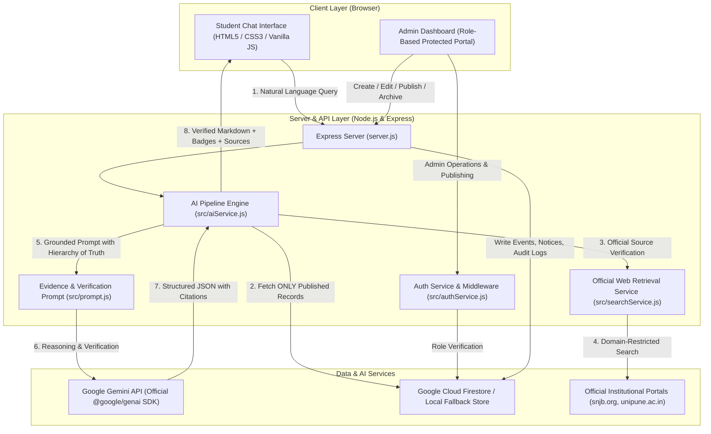

# 🎓 Convocation Assistant AI Agent
### Production-Structured College Engineering Project

An intelligent, multi-institution AI Agent and Administrative Management System that connects graduating students and college administrators for convocation ceremony inquiries, registration guidelines, deadlines, fee details, certificate collection, and verified official circulars.

---

## 📌 1. Project Overview & Problem Statement

### The Problem
During college convocation cycles, thousands of graduating students frequently overwhelm administrative offices, email inboxes, and department coordinators with repetitive queries regarding:
- Ceremony dates, reporting schedules, and reporting times.
- Online registration steps, regular deadlines, and late fee penalties.
- Degree eligibility criteria and backlog policies.
- Required identity proofs, fee payment receipts, and passing certificates.
- Academic dress codes (formal wear, stoles/uttariya, security deposits).
- Guest limits and parent seating passes.
- Degree certificate collection (in-person vs. In-Absentia postal dispatch).

Existing institutional solutions typically consist of static website notices or PDF circulars scattered across multiple portals (college websites, university boards like SPPU). Students struggle to locate timely updates, and traditional generic chatbots hallucinate answers, rely on stale keyword matching, or break when administrative updates are published.

### The Solution
The **Convocation Assistant AI Agent** bridges this gap:
1. **Authorized College Staff** use a secure **Administrator Dashboard** to create, edit, preview, and publish convocation events, fee schedules, guest rules, and official circulars.
2. The **AI Request Pipeline** (powered by the official **Google GenAI SDK** and live official institutional retrieval) reasons strictly over **published database records** (Firestore) as the primary ground truth.
3. **Drafts are strictly excluded** from student responses until an administrator officially clicks "Publish".
4. When published, the AI automatically uses the new information **without modifying application code or retraining models**.
5. Every student inquiry receives a natural conversational response in their preferred language (**English**, **Marathi (मराठी)**, or **Hindi (हिन्दी)**) accompanied by **verifiable source citations** and explicit **Verification Status Badges**.

---

## 🏗️ 2. System Architecture



### 10-Step AI Request Pipeline
1. **Natural Language Understanding**: Parses student input across English, Marathi, or Hindi.
2. **Context & Intent Extraction**: Identifies topic (ceremony date, fee, deadline, documents, dress code, certificate).
3. **Authoritative Retrieval**: Queries Firestore database for currently published records for the selected institution.
4. **Draft Isolation**: Strictly excludes `draft` status records from public answers.
5. **Official Web Retrieval**: Validates external sources against approved institutional domains (`snjb.org`, `unipune.ac.in`).
6. **Prompt Synthesis**: Assembles retrieved evidence with strict hierarchy of truth (College Database > University Notices > General Web).
7. **Gemini Grounded Reasoning**: Uses Google Gemini (`gemini-2.5-flash`) at temperature 0.2 for strict factual fidelity.
8. **Verification Categorization**: Classifies answer into one of 4 standardized statuses:
   - `Verified — Published by College`
   - `Verified — Official Source`
   - `Historical`
   - `Unconfirmed`
9. **Citations & Metadata Extraction**: Attaches clickable source URLs, notice titles, and publication dates.
10. **Context Preservation**: Maintains multi-turn conversation memory for seamless follow-up inquiries.

---

## 🛠️ 3. Technologies Used

- **Frontend**: HTML5, Modern CSS3 (Academic Navy Blue `#0a192f` & Gold `#c8963e` theme), Vanilla JavaScript (No heavy frameworks; lightweight, easy for college viva explanations).
- **Backend**: Node.js (v18+ / v24+), Express.js framework, CORS, Rate Limiting (`express-rate-limit`).
- **AI Engine**: Google Gemini API via the official current `@google/genai` SDK (`^2.29.1`).
- **Database**: 
  - **Primary**: Google Cloud Firebase Firestore (via `firebase-admin`).
  - **Local Development / Offline Viva Fallback**: Built-in structured local storage (`data/local-store.json`) ensuring the application runs out of the box even before cloud credentials are created!
- **Authentication**: Firebase Authentication (Email/Password) with server-side role validation and audit logging.
- **Environment**: Centralized configuration through `dotenv` (`.env.example`).
- **Portability**: 100% portable for Visual Studio Code running on Windows, macOS, or Linux.

---

## 🏛️ 4. Multi-Institution Data Model

The application supports configuring multiple engineering colleges or universities:
- **Default Institution**: **SNJB's Late Sau. Kantabai Bhavarlalji Jain College of Engineering, Chandwad** (`snjb_coe`), affiliated with **Savitribai Phule Pune University (SPPU)**.
- **Configurable Settings**:
  - Full Institution Name & Campus Address.
  - Official Website URL.
  - Affiliated University Name.
  - Approved Official Domains (`snjb.org`, `unipune.ac.in`).
  - Convocation Cell Contact (Email & Phone).

### Firestore Data Model
```
/institutions/{institutionId}
    ├── id: string (e.g. "snjb_coe")
    ├── name: string
    ├── shortName: string
    ├── location: string
    ├── website: string
    ├── affiliatedUniversity: string
    ├── officialDomains: array of strings
    ├── contactEmail: string
    ├── contactPhone: string
    ├── branding: { primaryColor, accentColor, tagline }
    │
    ├── /events/{eventId}
    │     ├── id: string
    │     ├── institutionId: string
    │     ├── status: "draft" | "published" | "archived"
    │     ├── title: string
    │     ├── academicYear: string
    │     ├── ceremonyDate: string (YYYY-MM-DD)
    │     ├── startTime: string
    │     ├── endTime: string
    │     ├── reportingTime: string
    │     ├── venue: string
    │     ├── registrationOpenDate: string
    │     ├── registrationDeadline: string
    │     ├── lateRegistrationDeadline: string
    │     ├── registrationUrl: string
    │     ├── fees: { regular, late, inAbsentiaPostal, currency }
    │     ├── eligibilityCriteria: string
    │     ├── requiredDocuments: array of strings
    │     ├── guestPolicy: string
    │     ├── dressCode: string
    │     ├── certificateCollection: string
    │     ├── publicationDate: ISO timestamp
    │     └── updatedBy: admin email
    │
    ├── /notices/{noticeId}
    │     ├── id: string
    │     ├── title: string
    │     ├── category: string
    │     ├── publicationDate: string
    │     ├── effectiveDate: string
    │     ├── documentUrl: string
    │     ├── summary: string
    │     └── status: "draft" | "published" | "archived"
    │
    └── /audit_logs/{logId}
          ├── action: "CREATE_EVENT" | "UPDATE_EVENT" | "PUBLISH_EVENT" | ...
          ├── targetId: string
          ├── adminEmail: string
          └── timestamp: ISO timestamp

/admins/{adminId}
    ├── email: string
    ├── role: "admin"
    └── institutionId: string
```

---

## 🔒 5. Firestore Security Rules

Deploy these rules directly to the Firebase Console (**Firestore Database → Rules**):

```javascript
rules_version = '2';
service cloud.firestore {
  match /databases/{database}/documents {
    
    function isAuthenticated() {
      return request.auth != null;
    }
    
    function isCollegeAdmin() {
      return isAuthenticated() && 
        exists(/databases/$(database)/documents/admins/$(request.auth.uid));
    }

    match /institutions/{institutionId} {
      allow read: if true;
      allow write: if isCollegeAdmin();
    }

    match /institutions/{institutionId}/events/{eventId} {
      // Students can ONLY read PUBLISHED events. Drafts are private.
      allow read: if resource.data.status == 'published' || isCollegeAdmin();
      allow write: if isCollegeAdmin();
    }

    match /institutions/{institutionId}/notices/{noticeId} {
      // Students can ONLY read PUBLISHED notices.
      allow read: if resource.data.status == 'published' || isCollegeAdmin();
      allow write: if isCollegeAdmin();
    }

    match /admins/{adminId} {
      allow read, write: if isCollegeAdmin();
    }

    match /institutions/{institutionId}/audit_logs/{logId} {
      allow read, write: if isCollegeAdmin();
    }
  }
}
```

---

## 🚀 6. Installation & Visual Studio Code Setup Guide

### Step 1: Open Project in Visual Studio Code
1. Launch **Visual Studio Code**.
2. Click **File → Open Folder...** and select `Convocation- Assistant`.
3. Open the integrated terminal (`Ctrl + \`` or **Terminal → New Terminal**).

### Step 2: Install Node.js Dependencies
Run:
```bash
npm install
```
*(On Windows PowerShell, if script execution policy is restricted, use `npm.cmd install` or run terminal in CMD).*

### Step 3: Configure Environment Variables
Copy `.env.example` to create `.env`:
```bash
cp .env.example .env
```
*(On Windows PowerShell: `Copy-Item .env.example .env`)*

Edit `.env` with your preferred settings:
```ini
PORT=3000
NODE_ENV=development

# Google Gemini API Key from Google AI Studio: https://aistudio.google.com/app/apikey
GEMINI_API_KEY=your_actual_gemini_api_key_here
GEMINI_MODEL=gemini-2.5-flash

# Default Institution
DEFAULT_INSTITUTION_ID=snjb_coe

# Offline / Demo Master Security Key
ADMIN_DEV_KEY=convocation_admin_secret_dev_key_2025
```

> **Note on Firebase Credentials**:
> The application includes an intelligent **dual-engine architecture**. If you haven't set up Firebase yet, it operates automatically using the local structured database (`data/local-store.json`) with pre-seeded data for SNJB COE.
> When you are ready to link live Firebase, simply place your `serviceAccountKey.json` in the root folder or set `FIREBASE_PROJECT_ID`, `FIREBASE_CLIENT_EMAIL`, and `FIREBASE_PRIVATE_KEY` in `.env`.

### Step 4: Provision an Initial Administrator
To provision or test the initial college administrator:
```bash
npm run setup-admin
```
Default demo credentials:
- **Email**: `admin@snjb.org`
- **Password**: `Admin@SNJB2025`
- **Security Key**: `convocation_admin_secret_dev_key_2025`

### Step 5: Start the Server
```bash
npm start
```
Or with auto-reloading during development:
```bash
npm run dev
```

### Step 6: Access the Application in Your Browser
- **🎓 Student Chat Assistant**: [http://localhost:3000/](http://localhost:3000/)
- **🔐 Administrator Portal**: [http://localhost:3000/admin](http://localhost:3000/admin)
- **📡 Server Health & Mode**: [http://localhost:3000/api/health](http://localhost:3000/api/health)

---

## 🧪 7. Running the Automated Test Suite

We have provided a comprehensive, 7-part automated test suite that tests the entire architecture without manual intervention:

```bash
npm test
```

### What `npm test` Verifies:
1. **Health & System Endpoints**: Server status, DB identification, institutions list.
2. **Draft Isolation & Security**: Confirms that draft records are 100% blocked from student context.
3. **Role-Based Authorization**: Rejects unauthorized and forged tokens with HTTP 401; permits authorized admin tokens.
4. **Dynamic Publishing Workflow**:
   - Creates a draft notice.
   - Verifies the chatbot cannot see it.
   - Admin publishes it.
   - Verifies that the AI Agent instantly incorporates the notice without code changes.
5. **Student AI Request Pipeline**: Checks answer generation, ceremony date (2025-03-22), venue, and `Verified — Published by College` badge.
6. **Multilingual Processing**: Confirms accurate responses in Marathi (`mr`) and Hindi (`hi`).
7. **Domain Boundary Enforcement**: Restricts external retrieval to `snjb.org` and `unipune.ac.in` while rejecting generic blogs.

---

## 💻 8. Administrator Workflow Demonstration (Viva Walkthrough)

Here is how you can demonstrate the project during a college viva:

1. **Open the Student Chat** ([http://localhost:3000/](http://localhost:3000/)):
   - Click the suggested button: *"When is the next convocation?"*
   - Show that the assistant returns **March 22, 2025** with venue Dr. K. B. Jain Auditorium and the badge `Verified — Published by College`.
   - Ask in Marathi: *"दीक्षांत समारंभाची तारीख कधी आहे?"*
   - Show that the agent responds naturally in Marathi while keeping the date and details identical.

2. **Open the Admin Portal** ([http://localhost:3000/admin](http://localhost:3000/admin)):
   - Sign in with `admin@snjb.org` / `Admin@SNJB2025`.
   - Show the **Dashboard Overview** with real metrics (Ceremony Date, Registration Status, Drafts).
   - Go to **Convocation Events**:
     - Click **Create New Event** or edit the existing draft.
     - Show the **Live Preview** modal.
     - Click **Publish**.
   - Return to the **Student Chat** and ask the question again.
   - Show that the AI Agent **immediately answers with the new information** without any code changes!

---

## 🛡️ 9. Security & Reliability Highlights

- **Server-Side API Key Isolation**: Gemini API keys are never exposed to browser client code.
- **Untrusted Web Content Sanitization**: External pages and notices are stripped of HTML and script tags before prompt injection.
- **Prompt Injection Defense**: Clear system role boundaries ensure external notices cannot instruct the AI to override administrative policy.
- **Role-Based API Enforcement**: All admin endpoints (`/api/admin/*`) require verified Bearer tokens.
- **Transparent Fallback**: If Gemini API is unreachable or missing an API key, the system provides accurate deterministic reasoning directly from verified database records rather than fabricating fake answers.

---

## 📄 License
Developed for Academic Engineering Demonstration & College Convocation Management. Free to use and extend.
